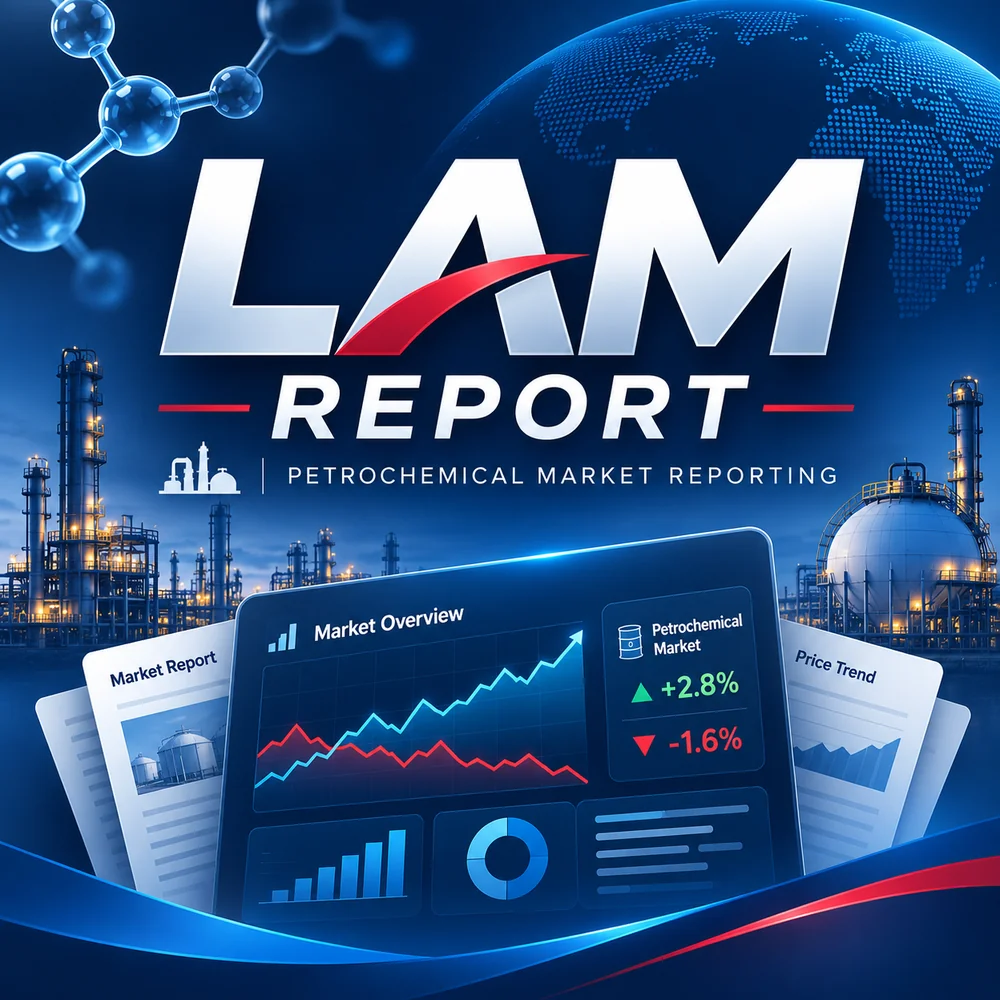

# LAM REPORT · 석유화학 18품목 위클리

**[18품목 위클리 앱 열기](https://jskimlam.github.io/petrochem-weekly-18/)**

석유화학 시장 18개 품목의 주간 가격·시황·전망 AS와 주차별 아카이브를 확인하는 웹 앱입니다.

- **메인 앱:** `index.html`
- **브랜드 이미지:** `assets/lam-report-cover.webp`
- **모바일 아이콘:** `assets/lam-report-icon-192.png`, `assets/lam-report-icon-512.png`
- **브라우저 파비콘:** `assets/lam-report-icon-64.png`
- **모바일 홈 화면:** `site.webmanifest`

주차별로 HTML을 별도 생성하지 않고, 하나의 `index.html`에서 주간 아카이브를 선택합니다.

> 공개 저장소에 포함된 시장 자료의 재배포 권한은 사용자가 별도로 확인해야 합니다.
